  

<h2 align="center">Research the problem. Build the system. Review the result.</h2>

  <a href="https://vikhyath2.github.io/vikhyath2/portfolio/"><strong>✦ Enter the interactive profile ↗</strong></a>
  &nbsp; · &nbsp;
  <a href="https://github.com/vikhyath2?tab=repositories">Explore repositories</a>

  

I build practical AI engineering projects focused on structured extraction, evaluation, and operational workflows. The work below is documented in my public repositories.

### Selected work

| Project | What I built |
| --- | --- |
| **[AI Engineering Lab](https://github.com/vikhyath2/ai-engineering-lab)** | Python exercises for LLM APIs, Spark log extraction, Pydantic validation, token usage analysis, and evaluation. The repository documents **50 labeled Spark log cases** and **six passing local regression tests**. Full model accuracy benchmarking remains future work. |
| **[AI Incident Automation Platform](https://github.com/vikhyath2/ai-incident-automation-platform)** | A FastAPI incident analysis and severity classification service with structured guidance, SQLite history, log upload, and critical alert handling. |
| **[CodeLift AI](https://github.com/vikhyath2/codelift-ai)** | A codebase onboarding MVP using React and Vite, AWS Lambda and S3 processing, and Amazon Bedrock report generation. Its README documents a local demo mode and archive inspection safeguards. |

### Tools and methods

`Python` · `FastAPI` · `Pydantic` · `OpenAI API` · `SQLite` · `DuckDB` · `SQL` · `React` · `Vite` · `Amazon Bedrock` · `Structured extraction` · `Evaluation`

### Activity

[Live contribution calendar](https://github.com/vikhyath2#user-activity-overview) · [GitHub YOLO achievement](https://github.com/vikhyath2?achievement=yolo&tab=achievements)

The interactive page adds scroll-driven Research → Build → Review storytelling and pointer-responsive visuals. GitHub displays its own live contribution heatmap on my profile.
